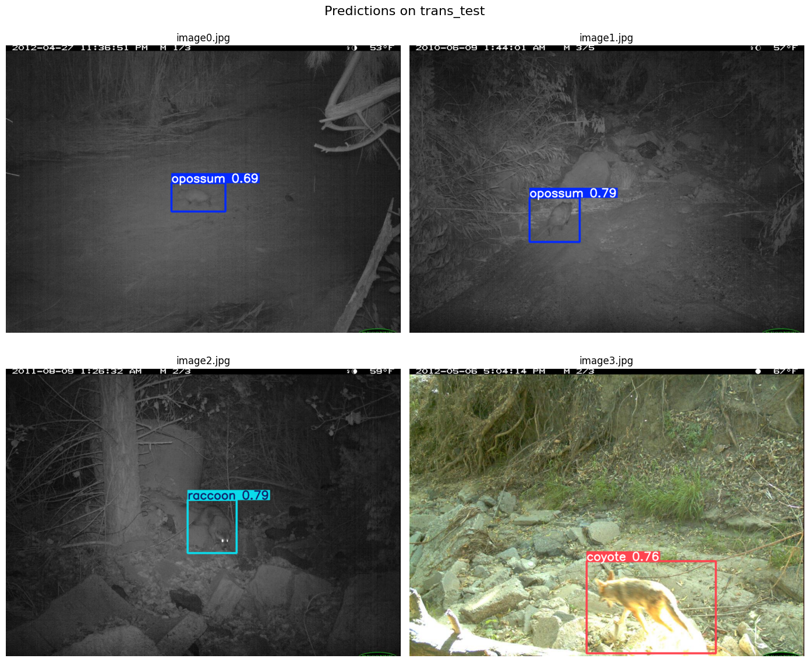

# DL-project-group35 — Wildlife Monitoring with YOLO11

A deep learning research project for detecting wildlife in camera-trap images and studying how well a detector transfers to unfamiliar camera locations. The project uses **Ultralytics YOLO11**, the **Caltech Camera Traps ECCV 2018 benchmark (CCT-20)**, and experiments aimed at reducing dependence on background, lighting, and camera-specific visual patterns.

Five Jupyter notebooks cover data preparation, a stock-architecture baseline, attention and normalization changes, domain-adversarial experimentation, and night/infrared-style augmentation. They provide an existing research foundation for the proposed application **Urban Wildlife Monitoring with Bias-Aware YOLO11**, under **AI in Urban Tech**.

**Status:** notebook-based research prototype with saved training and evaluation outputs. An urban monitoring interface, local field validation, and operational deployment are proposed next steps. The modified architectures have not demonstrated an overall cross-location improvement over the saved baseline.

- [Championship project proposal](PROJECT_PROPOSAL.md)
- [Experiment results and evidence notes](docs/EXPERIMENT_RESULTS.md)
- [Notebooks](#notebooks)
- [How to run the project](#how-to-run-the-project)

## Problem and motivation

Camera traps can collect many more images than researchers can quickly review. Automated detection can help prioritize images, but it must remain useful when a camera moves to a different site.

Fixed cameras create a challenge: the background repeats, and species frequencies can differ by location. A model may learn these contextual patterns instead of relying sufficiently on the animal's appearance. Performance at familiar locations can therefore overstate performance at new locations. The [CCT dataset](https://beerys.github.io/CaltechCameraTraps/) was designed to study this problem, including day/night variation, small animals, motion blur, and occlusion.

This project asks: **Can architecture changes and training augmentations improve wildlife detection across camera locations while preserving detection quality at familiar sites?**

## Relevance to AI in Urban Tech

The proposed application would help park managers, municipal environmental teams, and conservation researchers review wildlife observations from urban parks, green corridors, and city-edge habitats. Planned outputs include annotated images, candidate species labels, confidence scores, and reviewed activity summaries by site and time.

This is an application direction, rather than an existing city deployment. CCT images come from the Southwestern United States; another city's species and camera conditions need separate validation. Repeated capture frames must be grouped before generating activity summaries, and detection counts do not directly estimate animal population size.

## Notebooks

| Notebook | Purpose | Evidence/status |
| --- | --- | --- |
| [BASELINE.ipynb](BASELINE.ipynb) | Stock YOLO11s architecture with CCT conversion, weighted classification loss, photometric augmentation, and cis/trans evaluation. | Saved training and final test metrics; recommended starting point. |
| [arch_changed.ipynb](arch_changed.ipynb) | Early Instance Normalization and CBAM attention, with explicit mapping of compatible pretrained layers. | Saved training and final test metrics. |
| [arch_dann.ipynb](arch_dann.ipynb) | Experimental DANN-style branch with gradient reversal, a domain discriminator, and target-image loading from `trans_val`. | Saved training/test outputs repeat the architecture notebook's outputs; no independently evaluated DANN result is established. |
| [p2_arch.ipynb](p2_arch.ipynb) | Fourier style transfer, night/IR simulation, and optional bounding-box-aware background suppression. | Saved test metrics exist, but do not establish every current transform's effect. Fresh training selects `WildlifeBiasTrainer`; suppression requires `WildlifeBiasTrainerV2`. |
| [IR_best_simpl.ipynb](IR_best_simpl.ipynb) | Simpler night/IR augmentation and a side-by-side diagnostic, using the custom architecture and mapped pretrained weights. | Saved training stops during epoch 28 of 30; the final test cell has no saved output. The filename is not a verified ranking. |

## Dataset and preprocessing

The notebooks expect the CCT-20 image subset and these annotation files:

```text
train_annotations.json
cis_val_annotations.json
trans_val_annotations.json
cis_test_annotations.json
trans_test_annotations.json
```

**Cis** splits represent familiar camera locations; **trans** splits represent locations held out from the supervised training split. The notebooks use `trans_val` for checkpoint selection, monitor `cis_val` separately, and include both final test evaluations. DANN also intends to use `trans_val` images as unlabeled adaptation data; it needs a separate adaptation/validation design for a fair comparison.

The conversion pipeline indexes images, maps categories to contiguous IDs, writes normalized YOLO boxes, and generates dataset YAML files. Images without usable boxes receive empty label files. Training samples these images with `KEEP_EMPTY_TRAIN_FRAC = 0.25`; validation and test splits retain them all.

Saved preparation output records **57,864 indexed images** and **16 category names**, including `car` and `empty`; this is not a set of 16 animal species. The `empty` category has no training-box instances in the saved class-count table. Empty-frame handling should be evaluated separately from species detection.

| Split | Images in annotation JSON | Images written in the saved preparation run |
| --- | ---: | ---: |
| train | 13,553 | 12,456 |
| cis_val | 3,484 | 3,484 |
| trans_val | 1,725 | 1,725 |
| cis_test | 15,827 | 15,827 |
| trans_test | 23,275 | 23,275 |

The post-sampling training count is run-dependent. Obtain benchmark images and split annotations from the [official CCT downloads](https://lila.science/datasets/caltech-camera-traps), rather than substituting the full dataset with a different split protocol.

## Methods

- **YOLO11s baseline:** standard architecture with a custom trainer for weighted loss and additional cis validation.
- **Instance Normalization and CBAM:** early normalization and deeper channel/spatial attention are intended to reduce sensitivity to style and improve feature selection. Their benefit needs evaluation.
- **Pretrained weight mapping:** inserted layers shift indices; explicit mapping transfers compatible source tensors into the modified architecture.
- **Class imbalance:** inverse-square-root weights, clipped at 6.0, are computed from training-box counts and applied to classification loss.
- **Augmentation:** brightness, contrast, gamma, color, safe crop, occlusion, and mosaic expose the model to appearance variation. Current training calls set `mixup=0.0` and `cutmix=0.0`.
- **Experimental branches:** night/IR-style transforms, Fourier style transfer, background suppression, and DANN provide hypotheses for further controlled experiments.

## Saved results

These values come from final `eval_df` outputs. They are **historical saved results**, not a fresh reproduction or proof that all current code paths were active.

| Notebook | cis_test mAP50 | cis_test mAP50–95 | trans_test mAP50 | trans_test mAP50–95 |
| --- | ---: | ---: | ---: | ---: |
| BASELINE.ipynb | 0.778203 | 0.514975 | 0.486425 | **0.321051** |
| arch_changed.ipynb | 0.783622 | 0.514301 | 0.484752 | 0.312920 |
| p2_arch.ipynb | 0.769448 | 0.486633 | 0.484081 | 0.304591 |

`mAP50` averages detection AP at IoU 0.50. `mAP50–95` averages AP across IoU thresholds from 0.50 to 0.95; neither is classification accuracy.

The baseline has the highest saved `trans_test` mAP50–95 among these runs. All show a substantial cis/trans gap. A smaller gap alone is insufficient evidence of improvement if both scores decline. See the [full metrics and interpretation](docs/EXPERIMENT_RESULTS.md) before making performance claims.

### Example predictions



This figure is copied unchanged from the saved prediction cell in `arch_changed.ipynb`. It illustrates day and night detections; four examples do not establish generalization performance. Labels show predicted classes and confidence. Underlying images are from CCT; see attribution below.

## How to run the project

### Recommended: Kaggle with a GPU

1. Upload a notebook to Kaggle; start with `BASELINE.ipynb`.
2. Enable a GPU and attach CCT-20 images and annotation files. Edit the image/annotation roots to match mounted datasets. Existing paths refer to `jajaganj/wildlife` and `jajaganj/wildlife-annotations`.
3. Run package-check and import cells. Internet is needed if dependencies or `yolo11s.pt` are missing; otherwise supply them locally.
4. Run configuration and conversion cells. Check class mapping, missing-image count, split sizes, and labels before training.
5. Review actual training arguments, augmentation previews, and directories. Use a unique run name, then run training and both test evaluations.
6. Export checkpoints, `results.csv`, `cis_val_history.csv`, and `test_metrics.csv`, with the configuration and package versions.

### Local Jupyter environment

```bash
git clone https://github.com/jaja-ganj/DL-project-group35.git
cd DL-project-group35
python3 -m venv .venv
source .venv/bin/activate
python -m pip install jupyterlab ultralytics albumentations pycocotools pyyaml pandas matplotlib opencv-python tqdm torch torchvision
jupyter lab
```

Choose the appropriate GPU build using the [official PyTorch installation guide](https://pytorch.org/get-started/locally/). Replace `/kaggle/input/...` and `/kaggle/working/...` paths before execution. This dependency command is a starting environment, not a validated version lock.

Saved runs report Python 3.12.12, Ultralytics 8.4.47, PyTorch 2.10.0+cu128, and a Tesla T4 GPU. Common settings: 640-pixel input, batch 8, seed 42, AdamW, and initial learning rate 0.0008. Baseline/main architecture configuration request 60 epochs. The IR training call explicitly requests 30 despite defining `EPOCHS = 60`. Early stopping can shorten runs.

## Reproducibility and limits

- Images and trained checkpoints are not committed. Custom notebooks optionally use an external Kaggle baseline checkpoint, otherwise public YOLO11 weights; record the source used.
- Ultralytics internals are used without a complete dependency lock. Saved Albumentations warnings show ignored older argument names. Confirm actual transforms and pin a working environment.
- Some narrative describes disabled options, including early-layer freezing. Inspect executed arguments and outputs.
- Verify DANN trainer integration, feature dimensions, and gradient flow before reporting an adversarial result. Separate adaptation, validation, and test data.
- If Ultralytics suffixes a reused run name, use the actual trainer output directory for checkpoint lookup.
- Local species, unknown species, empty-frame false positives, and rare classes need dedicated evaluation. Confidence is not a calibrated probability of correctness.

## Planned development

The [proposal](PROJECT_PROPOSAL.md) describes an indicative eight-week plan after selection: reproduce the baseline, evaluate changes independently, complete robustness experiments, and build an image-review demonstration with CSV export. A permitted urban pilot would assess transfer and review effort. These are planned deliverables.

## Attribution and references

- **Dataset:** Beery, Van Horn, and Perona, [Recognition in Terra Incognita](https://arxiv.org/abs/1807.04975), ECCV 2018; [CCT](https://beerys.github.io/CaltechCameraTraps/) and [LILA BC](https://lila.science/datasets/caltech-camera-traps) provide access and terms.
- **Framework:** [Ultralytics YOLO11](https://docs.ultralytics.com/models/yolo11/).
- **Attention:** Woo et al., [CBAM](https://arxiv.org/abs/1807.06521), ECCV 2018.
- **Adaptation:** Ganin et al., [Domain-Adversarial Training of Neural Networks](https://arxiv.org/abs/1505.07818), JMLR 2016.
- **Fourier method:** Yang and Soatto, [Fourier Domain Adaptation](https://arxiv.org/abs/2004.05498), CVPR 2020; the notebook adapts the idea to detection augmentation.

No project license file is currently included. Dataset and third-party software terms apply independently; consult their original sources when reusing material.
